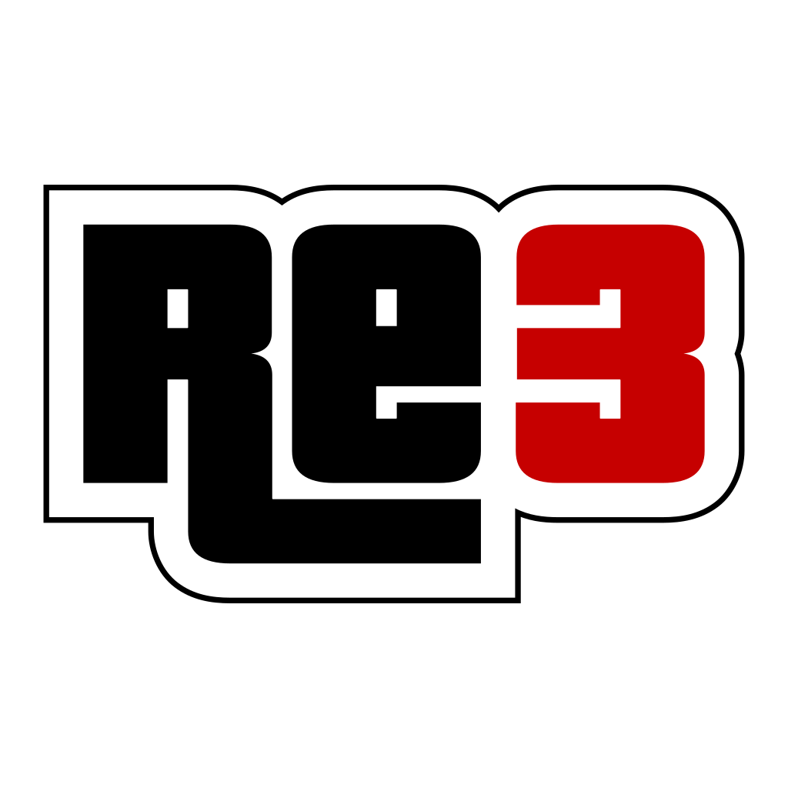

# re3-PS3

**re3 (GTA III) for the PlayStation 3**, as homebrew built with PSL1GHT.

re3 is the reverse-engineered source code of GTA III. This port runs it
natively on the PS3, with a hardware renderer on the RSX (a PS3 backend for
librw), DualShock 3 controls in the PS2 style, and the game's data read from
your own PC copy.

> **Status: 1.4 alpha.** All of the game's missions, the odd jobs and the
> collectibles have been run through the automatic test on real hardware
> without crashes, and the game has been played to 100% on a real PS3. Expect
> bugs anyway and please report them with the log (see
> [Troubleshooting](#troubleshooting)).
> Only tested on real consoles, not on RPCS3.
>
> 1.1 alpha brings the fixes found while making
> [reVC-PS3](https://github.com/stingziz0u/reVC-PS3) 1.1.2: code that only
> worked with the PC compiler (compiler optimizations that broke the original
> code, unset variables, loops that could freeze the game), particles animated
> past the end of their texture list, saves that wrote pointers unaligned,
> full pools and stale pointers, half the smoke particles at 60 fps, DXT1
> textures in 16 bits in video memory, and a log that records what the game
> was doing when it crashes or freezes. New: right stick sensitivity
> settings, and graphics options: mipmaps, texture filtering (bilinear,
> trilinear, anisotropic) and antialiasing (FXAA), and fewer hitches when
> new areas stream in (textures converted several times faster, spread
> over frames, and the log written in the background).
>
> 1.2 alpha brings what [reVC-PS3](https://github.com/stingziz0u/reVC-PS3)
> 1.3 found: DXT textures stay compressed in video memory, where the RSX
> reads them as they are (4 times less VRAM, and nothing to convert when an
> area streams in); textures are converted on the PPU's second thread and
> mip levels use AltiVec; big smoke and explosion particles right in front
> of the camera fade out (explosions no longer swamp the RSX). It fixes a
> crash from deleted objects left in the physics list and other stale
> pointers, and after a crash the game goes back to the XMB instead of
> freezing the console.
>
> 1.3 alpha brings what [reVC-PS3](https://github.com/stingziz0u/reVC-PS3)
> 1.4 found: the hidden packages and rampages on the radar and the map
> (optional), a car spawner (L3 + R3), the vehicle rampages get the traffic
> they need, mission cars no longer deleted under the mission script, the
> police sirens switch on with a tap of L3 at 60 fps, and the player no
> longer stays stuck in the air between objects (see
> [Changes from the original](#changes-from-the-original)). The log now
> records what a mission script waits for, the pools every 10 s, and more
> of the audio.
>
> 1.4 alpha adds the unique jumps to the collectibles on the map, and
> brings the MP3 player's volume boost of Vice City (*Audio > MP3
> volume boost*, under SFX), Vice City's aiming as an option (camera on the
> target, targets in front of the player first), stick dead zones (from the
> game's 30%) on a new *Stick settings* page, a vibration option, the `mods`
> folder (files that replace the game's, loose or inside the .img), and only
> pad 1 plays (pads 2-4 are ignored, as on the PS2). It fixes the static on
> the skid sounds after a long game and a crash in the audio, both from a
> bug of the PC game that wrote past the end of the sound queue, a crash
> opening the map after a while (video memory running out), the green
> blocks on the map, and the PC keyboard and mouse help texts left in the
> menus. Textures that don't fit in video memory stay as DXT instead of
> showing white, pausing takes a few milliseconds instead of 1-2 seconds,
> the right stick sensitivity goes down to 20%, and the car spawner is off
> unless `USRDIR/carspawner.txt` exists.
>
> **Known issues:**
> - The pause menu stopped taking input once, on the way to loading a game
>   (still drawn, the game running). The log now records every menu page
>   and why a menu takes no input; if it happens to you, please send it.
> - Vibration: the option is there, but the pad didn't vibrate in the tests
>   (the console takes the commands). Check that *Controller Vibration* is
>   on in the XMB settings.

**No game data is included.** You need a legally purchased copy of GTA III
for PC. The PKG only has the program, its icon and two re3 files (the
PlayStation button icons and the controller picture of the settings page).

## Features

- Native 720p, rendered on the RSX: tiled colour/depth buffers, compressed
  depth and ZCULL, 60+ fps of headroom in the heavy scenes (rain and smoke).
- **30 fps** by default (the rate the game was made for) or **60 fps**:
  *Options > Graphics > Frame rate*. Always in sync with the TV (no tearing).
- PS2-style controls with lock-on aiming, four pad setups, button
  redefinition, inverted look, free camera, right stick sensitivity for third
  person (free camera) and first person (aiming, sniper, look around), 20% to
  200% in steps of 5 and stick dead zones, 5% to 70% (30% the game's
  own; the right one is also where the camera starts turning), in
  *Controller setup > Gamepad settings > Stick settings*; vibration in
  *Gamepad settings*. PlayStation buttons in the
  on-screen help.
- **Aiming: III / Vice City** (*Controller setup > Gamepad settings*): with
  Vice City, the camera when you lock on with a gun is Vice City's: it looks
  at the target, follows its height and keeps it in the middle of the
  screen, instead of III's over-the-shoulder camera that looks at the player.
  It also picks targets as Vice City does: only what is in front of the
  player, mission characters and whoever is after him first.
- **Map** in the pause menu, Vice City style: the game's radar tiles, every
  safehouse, Ammu-Nation, Pay 'n' Spray and bomb shop, waypoints with X.
- **Collectibles on the map** (*Display > Hidden packages / Rampages / Unique
  jumps on map*, each off by default): hidden packages in lime green,
  rampages in blood red and unique jumps (at the take-off) in orange, on the
  radar (the nearest one at its edge when none is in range) and the pause
  menu map. One you pick up, pass or jump disappears. The jumps come from the
  original `main.scm`: with a modified one they aren't shown.
- **Car spawner** (for testing, off unless there is a file named
  `carspawner.txt` in `USRDIR`, any content): L3 + R3 together on foot. The
  vehicle shows as "ID: name" over the subtitles; Left/Right go one by one,
  L1/R1 by 10 (hold to scroll), X puts you in it, O closes. Boats go on the
  water in front of you (up to 30 m). Trains, helicopters, planes and the RC
  Bandit aren't in the list.
- **MP3 player radio**: put `.mp3` files in `USRDIR/mp3`. *Audio > MP3 volume
  boost* raises it up to twice the music volume, as in Vice City.
- **Skins**: put `.bmp` skins in `USRDIR/skins`, choose them in *Player setup*.
- DXT textures (most of the PC game's) stay compressed in video memory and
  the RSX reads them as they are: 4 times less VRAM than converted, and
  nothing to convert when an area streams in. Mip levels made on the CPU use
  AltiVec.
- *Options > Graphics*:
  - **Mipmaps**: textures that come without smaller versions get them (less
    shimmering in the distance). They are made as textures load: restart
    the game for all of them. Uses more video memory.
  - **Texture filtering**: Default (the game's own), Bilinear, Trilinear,
    Anisotropic 2x to 16x (sharper ground and roads at an angle). With
    Mipmaps off, only the textures that have them in their TXD use them.
  - **Antialiasing**: Off or FXAA (smoother edges, a filter over the
    finished picture: ~2 ms of GPU time and 7 MB of video memory at 720p).
  All three are off/default unless you choose them.
- *Display > Screen size* for overscan, fixed aspect ratios shown with black
  bars, FPS counter (*Graphics > Show FPS*).
- Settings saved in `USRDIR/re3.ini`, saves in `USRDIR/userfiles`.

## Changes from the original

The PS2/PC game was tuned for the PS2's memory: a few things are hard for
that reason alone. re3-PS3 changes these (everything else plays as the
original):

- **Vehicle rampages** (blow up N cars of a kind): while one runs, the
  traffic limits are lifted and the cars of the rampage are asked for, so
  enough of them come.
- **Mission cars**: making room for a new mission entity no longer deletes
  a car a mission script has taken (the script stopped when it looked at
  it again).
- **Horn taps**: a tap of L3 shorter than 250 ms switches the sirens, a
  longer press honks. The original only took presses of 1-3 frames, too
  short at 60 fps.
- **Stuck in the air**: when the player is held in the air between objects
  for a while, he is put on top of what is under him, or back where he
  last stood.

## Installation

1. Install `re3-ps3-1.4-alpha.pkg` on a PS3 with homebrew support (CFW or
   HEN), e.g. copy it by FTP and install it with the package manager. It
   appears in the XMB as **re3**.
2. The PKG creates `/dev_hdd0/game/RE3PS3000/USRDIR` with these empty
   folders. From your GTA III PC installation, copy into them (by FTP):

   | Folder  | Contents                                   |
   |---------|--------------------------------------------|
   | `anim`  | the PC game's `anim` folder                |
   | `audio` | the PC game's `audio` folder (big: radio)  |
   | `data`  | the PC game's `data` folder                |
   | `models`| the PC game's `models` folder (keep the two re3 `.txd` already there) |
   | `text`  | the PC game's `text` folder                |
   | `txd`   | the PC game's `txd` folder (loading screens) |
   | `mp3`   | optional: your own music                   |
   | `skins` | optional: player skins (`.bmp`)            |

   Filenames are case-sensitive on the PS3: keep them lowercase, exactly as above.
3. Start **re3** from the XMB.

## Mods

**`USRDIR/mods`**, like a mod loader on the PC: a file put there (in any
subfolder, any letter case) is used instead of the game's file with the same
name, whether that one is loose (`hud.txd`, `handling.cfg`, `main.scm`...)
or inside `gta3.img` (`weapons.txd`, `infernus.dff`...). Nothing has to be
rebuilt: take a mod's files out of its folder or delete them and the
original ones are back. If two files have the same name, the one whose path
comes first in alphabetical order is used. The log lists every file
replaced (`[mods]` lines). Files in `USRDIR` itself (`re3.ini`, settings,
logs), `userfiles` and `mp3` are never replaced. `.img` files inside `mods`
aren't read: take the files out of them with an IMG tool.

Anything made for the PC version of GTA III as data files works:

- TXD textures (in `mods`, loose in `models`/`txd`, or inside `gta3.img`
  with an IMG tool on the PC, then copy `gta3.img` and `gta3.dir`): HD
  loading screens, HUD, fonts, vehicles, peds, buildings. All PC formats are
  read (palettized, 16/32 bit, DXT1/3/5).
- DFF models in GTA III PC format, in `mods` or inside `gta3.img`.
- Data files (`handling.cfg`, `carcols.dat`, `timecyc.dat`, `gta3.dat`...)
  and a modified `main.scm`.

Limits: on the PS3 DXT textures (power of two sizes) stay compressed, as on
the PC, and every other texture takes 4 bytes per pixel (uncompressed) in
the RSX's 216 MB. When video memory runs out (a pack of uncompressed HD
textures, e.g. a 64-tile HD map), the textures that don't fit any more are
compressed into DXT as they load (4 to 8 times smaller, a little less
sharp) instead of turning white; for the best quality, use DXT textures in
the pack. The largest texture size is 4096×4096. Code mods (CLEO, ASI,
plugins that patch the executable) and unconverted assets from other games
or platforms don't work.

## Troubleshooting

- The log is `USRDIR/re3-ps3.log` (the previous one: `re3-ps3.old.log`).
  Send it with any report: it says what the game was doing when it crashed.
- A black screen at start: create an empty `USRDIR/notiles.txt` (turns off
  the tiled buffers), and report it.
- A texture that looks wrong: create an empty `USRDIR/nodxt.txt` (DXT
  textures converted on the CPU, as before), and report it. If that
  isn't it, an empty `USRDIR/notexthread.txt` converts the textures on the
  game's own thread again (they are converted on a second PPU thread);
  `USRDIR/novmx.txt` makes the mip levels without AltiVec; and
  `USRDIR/dxt32.txt` keeps converted DXT1 textures in 32 bits instead of 16.
- `USRDIR/autotest.txt` runs an automatic test while you watch (load a save
  outdoors first). One line in it chooses the test: nothing (weather, a
  flight over the islands, save/load, side missions, garages), `mode=full`
  (every mission 30 s, odd jobs, rampage, collectibles — it changes the
  game's progress, don't save after it), `mode=gpu` (GPU benchmark),
  `mode=rain`, `mode=leak`. The file is renamed to `autotest.done.txt` when
  the test ends.

## Building

On Linux or WSL (Ubuntu):

1. Install the PS3 toolchain and PSL1GHT (https://github.com/ps3dev/ps3toolchain),
   which ends up in `/usr/local/ps3dev`.
2. Build:

   ```sh
   git clone https://github.com/stingziz0u/re3-PS3.git
   cd re3-PS3
   export PS3DEV=/usr/local/ps3dev PSL1GHT=/usr/local/ps3dev
   export PATH=$PS3DEV/bin:$PS3DEV/ppu/bin:$PATH
   make -C ps3 -j$(nproc)
   make -C ps3 verify
   ```

   The result is `ps3/re3-ps3-1.4-alpha.pkg`.

Other targets: `make -C ps3 DEBUG=1` (debug build with asserts),
`make -C ps3 STAGE=1` (headless test build: loads the game without video,
audio or pad, everything to the log), `make -C ps3 clean`.

The RSX shaders are in the tree already compiled
(`vendor/librw/src/ps3/ps3shaders.h`). To change them you need NVIDIA's `cgc`
and PSL1GHT's `cgcomp` with `cgcomp-relative-constants.patch`; see
`vendor/librw/src/ps3/shaders/build_shaders.sh`.

### Where things are

- `ps3/` — Makefile, PKG icon, patch level.
- `src/skel/ps3/` — platform layer: main loop, file system, pad, log, test.
- `src/audio/sampman_ps3.cpp` — audio (software mixer on libaudio, MP3/WAV streams).
- `vendor/librw/src/ps3/` — librw's RSX backend: VRAM, rasters, pipelines, shaders.
- `src/core/config.h` (`__PS3__` section) — what the PS3 build turns on and off.

## Credits

- The [re3 team](https://github.com/GTAmodding/re3) for re3, and aap for
  [librw](https://github.com/aap/librw).
- The [ps3dev](https://github.com/ps3dev) people for ps3toolchain and PSL1GHT.
- lieff for [minimp3](https://github.com/lieff/minimp3).

The original re3 README is kept as [README.re3.md](README.re3.md).

## License

See [LICENSE](LICENSE). Grand Theft Auto III is © Rockstar Games /
Take-Two Interactive. This project is not affiliated with or endorsed by
Rockstar Games, Take-Two Interactive or Sony Interactive Entertainment.

## AI disclosure

This project's code was written collaboratively with Claude (Anthropic),
working through this port with me in real time over many sessions. Every
bit of testing and debugging was done by me on real hardware.
